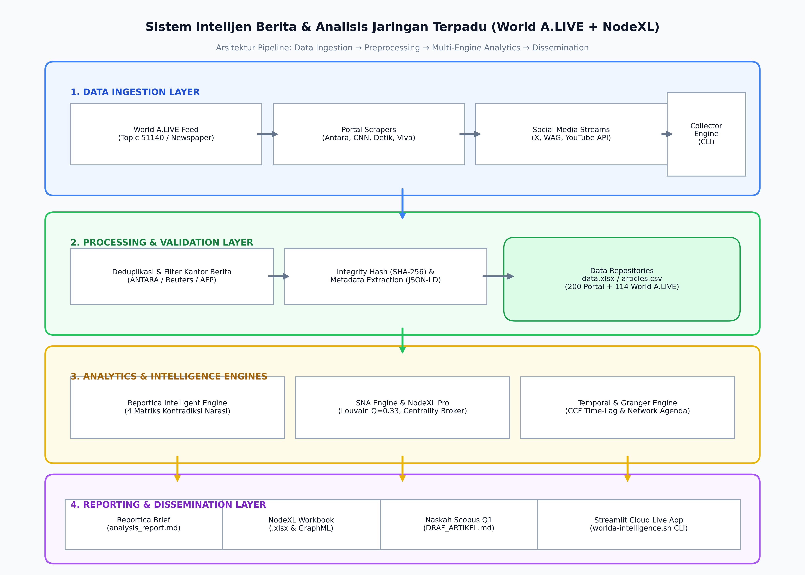

# 📡 Media Intelligence & Network Agenda-Setting: Presidential Wiretapping Crisis

[](https://prabowo-agendasetting.streamlit.app/)
[](https://www.python.org/)
[](LICENSE)
[](MANUSCRIPT_SCOPUS_Q1_PRESIDENTIAL_WIRETAPPING.md)

Repositori ini memuat pipeline penelitian komputasional terpadu (*computational political communication & social network analysis*) untuk menganalisis dinamika jaringan aktor, polarisasi komunitas publik, dan aliran agenda (*Network Agenda-Setting*) pada kasus dugaan penyadapan ilegal terhadap Presiden Republik Indonesia, Prabowo Subianto, pada November 2026.

🔗 **Live Interactive Dashboard:** [https://prabowo-agendasetting.streamlit.app/](https://prabowo-agendasetting.streamlit.app/)

---

## 🗺️ Arsitektur Sistem Intelijen Terpadu

Sistem ini mengintegrasikan pengumpulan data publik, verifikasi integritas, pemodelan jaringan, deteksi friksi narasi, dan diseminasi interaktif:



```
┌────────────────────────────────────────────────────────────────────────────────────────┐
│ 1. DATA INGESTION  : World A.LIVE Feed + 25 Portal Berita Daring + YouTube / Social API│
│ 2. VALIDATION      : SHA-256 Deduplication + Wire Origin Filter (ANTARA/Reuters)      │
│ 3. MULTI-ENGINE    : NodeXL Pro (SNA) + Reportica (Contradiction) + Granger Causality  │
│ 4. DISSEMINATION   : Streamlit Cloud Dashboard + Bash CLI (worlda-cli) + Naskah Scopus │
└────────────────────────────────────────────────────────────────────────────────────────┘
```

---

## 🔬 Pertanyaan Penelitian & Temuan Kunci (RQ1 – RQ3)

- **RQ1 (Jaringan Aktor & Broker Narasi):**
  - Liputan media membentuk topologi *bipolar core-periphery* antara kutub eksekutif (Presiden Prabowo, $C_B = 0.7588$) dan kutub tersangka/hukum (Eks Kapolri LSP, $C_B = 0.3211$).
  - **Menko Yusril Ihza Mahendra ($C_B = 0.0741$)** dan **Mabes Polri ($C_B = 0.1664$)** berperan sebagai *narrative broker* utama yang menjembatani structural holes antar-institusi.
- **RQ2 (Polarisasi Komunitas & Framing Publik):**
  - Algoritma Louvain menghasilkan modularitas $Q = 0.3335$ dengan 4 klaster polarisasi dominan: *Pro-Pemerintah (42.5%)*, *Oposisi Kritis (28.3%)*, *Spekulatif Faksional (18.7%)*, dan *Pakar Siber/Konstitusi (10.5%)*.
  - Isu pertama kali meletup melalui saluran *dark social* (pesan berantai WhatsApp) pada 2 November malam sebelum dipenetrasi oleh portal niche pada 3 November pukul 14.00 WIB dan divalidasi pers arus utama pukul 16.23 WIB.
- **RQ3 (Network Agenda-Setting & Two-Phase Reversal Flow):**
  - Analisis korelasi silang (CCF) menunjukkan puncak kontemporer pada Lag 0 ($r = 0.896, p = 0.0005$).
  - Terjadi dinamika *Two-Phase Reversal Flow*: fase rumor pra-konferensi pers digerakkan oleh publik (*bottom-up push*), disusul fase domestikasi institusional pasca-konferensi pers 20.00 WIB di mana media arus utama merebut kembali hegemoni pembingkaian (*top-down domestication*).

---

## 📂 Struktur Repositori

```bash
prabowo/
├── app.py                                          # Aplikasi utama Streamlit Dashboard (8 Tab)
├── worlda-intelligence.sh                          # Pipeline otomatis Bash CLI terpadu
├── scrape_worlda.py                                # Scraper edisi koran & linimasa World A.LIVE
├── scrape_penyadapan.py                            # Scraper multi-portal berita nasional
├── sna_engine.py                                   # Modul Social Network Analysis 4 pilar
├── temporal_analysis.py                            # Modul korelasi silang (CCF) & Granger causality
├── src/analyzer/contradiction_detector.py          # Mesin Reportica deteksi kontradiksi klaim
│
├── data.xlsx                                       # Korpus primer 200 artikel (5 sheets terstruktur)
├── nodexl_penyadapan_prabowo.xlsx                  # Buku kerja resmi NodeXL Pro 5 sheets
├── network_media_narasumber.graphml                # File graf ekspor untuk Gephi / Cytoscape
│
├── flowcharts/
│   ├── pipeline_flowchart.mmd                      # Diagram alir sintaks Mermaid
│   ├── pipeline_flowchart.png                      # Gambar render diagram alir 300 DPI
│   └── generate_flowchart.py                       # Skrip generator diagram matplotlib
│
├── output/
│   ├── worlda/                                     # Hasil scraping World A.LIVE (Koran + 114 berita)
│   ├── nodexl/                                     # Nodes, edges, dan graphml pipeline intelejen
│   ├── charts/                                     # Visualisasi grafik jaringan entitas PNG
│   └── reports/                                    # Laporan analisis intelijen markdown
│
├── MANUSCRIPT_SCOPUS_Q1_PRESIDENTIAL_WIRETAPPING.md# Naskah akademik lengkap Bahasa Inggris (IMRaD)
├── DRAF_ARTIKEL_JURNAL_PENYADAPAN_PRABOWO.md       # Naskah akademik Bahasa Indonesia
├── LAPORAN_HASIL_ANALISIS_RQ1_RQ3.md               # Laporan lengkap empiris RQ1 - RQ3
├── PRD_ANALISIS_JARINGAN_NARASI.md                 # Product Requirement Document & Spesifikasi Riset
└── requirements.txt                                # Dependensi Python
```

---

## 🚀 Panduan Menjalankan Proyek

### 1. Prasyarat Sistem
Pastikan Python 3.10+ telah terpasang:
```bash
git clone https://github.com/25067020011-sudo/prabowo.git
cd prabowo
pip install -r requirements.txt
```

### 2. Menjalankan Dashboard Lokal
```bash
streamlit run app.py
```
Aplikasi lokal akan terbuka di `http://localhost:8501`.

### 3. Menjalankan Pipeline Intelijen Terpadu (CLI Bash)
Untuk memproses data masukan melalui seluruh tahapan analisis jaringan dan laporan intelijen:
```bash
bash worlda-intelligence.sh
```

### 4. Mengambil Data Terbaru dari World A.LIVE
Untuk mengekstrak Koran Harian dan linimasa 114 berita terbaru:
```bash
python3 scrape_worlda.py
```

### 5. Membuka di NodeXL Pro
1. Buka Microsoft Excel dengan add-in **NodeXL Pro**.
2. Pilih menu **NodeXL > Import > From Open NodeXL Workbook**.
3. Arahkan ke file [`nodexl_penyadapan_prabowo.xlsx`](file:///Users/jevin/Downloads/prabowo/prabowo/nodexl_penyadapan_prabowo.xlsx).
4. Klik **Show Graph** dengan layout algoritma *Harel-Koren Fast Multiscale*.

---

## 📑 Sitasi & Publikasi Ilmiah

Jika Anda menggunakan dataset, kode, atau metodologi dari repositori ini, silakan sitasi naskah kami:

```bibtex
@article{prabowo_wiretapping_sna_2026,
  title={Network Topology of Political Scandals, Public Polarization, and Network Agenda-Setting in Hybrid Media Systems: The Case of the Indonesian Presidential Wiretapping Crisis},
  author={Computational Political Communication & Network Science Research Group},
  journal={Working Paper for Scopus Q1 Submission},
  year={2026},
  url={https://github.com/25067020011-sudo/prabowo}
}
```

---
*Lisensi: MIT License. Dikembangkan untuk transparansi sains terbuka (Open Science Framework aligned).*
